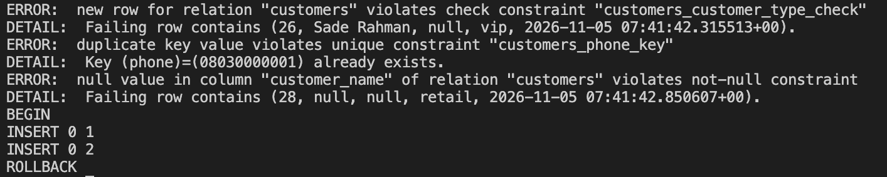
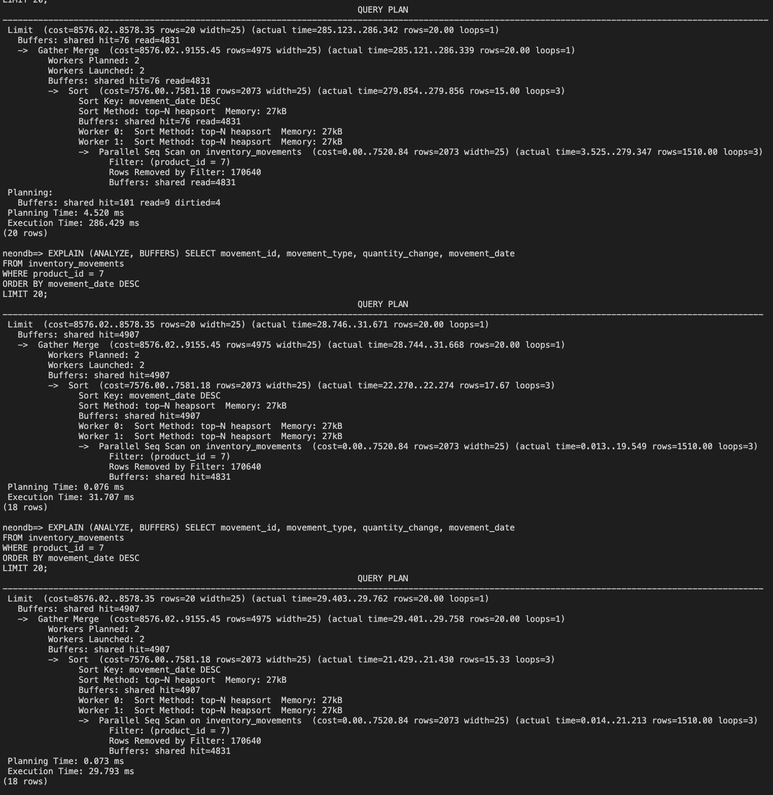
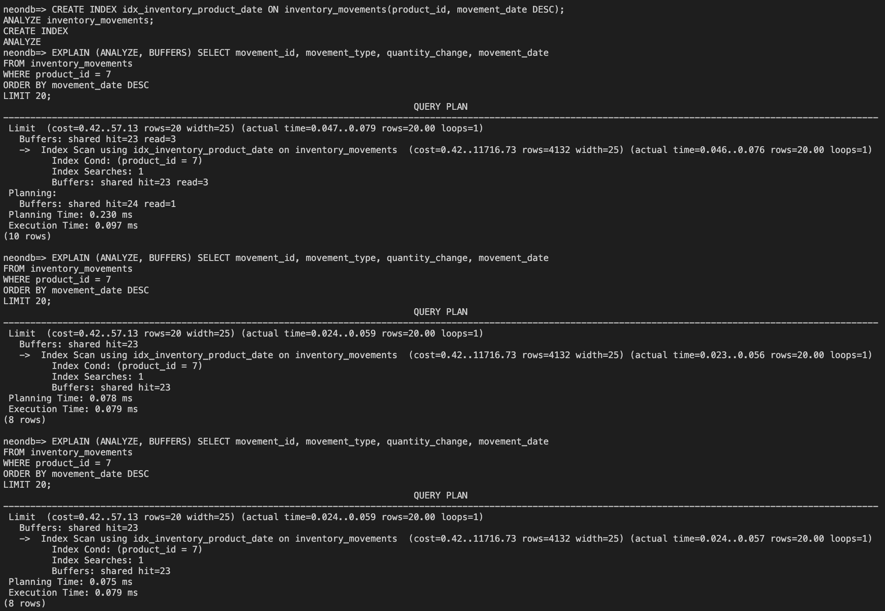
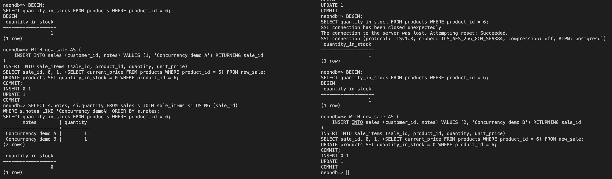
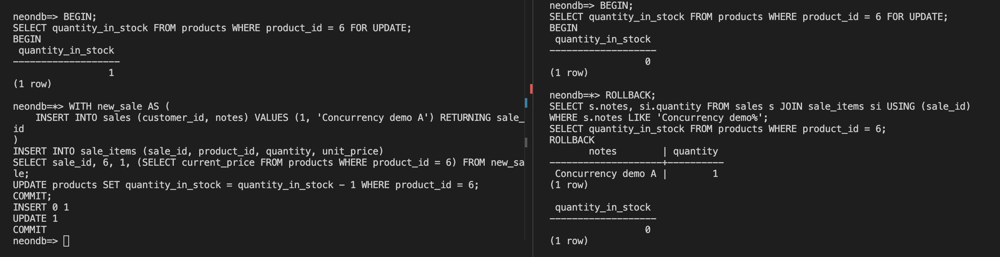
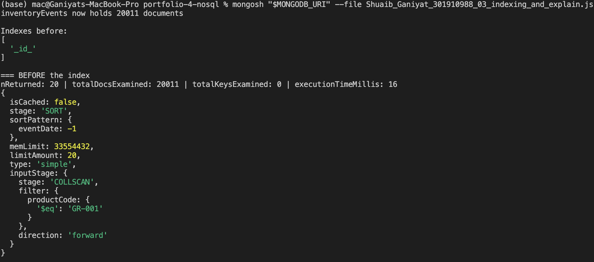
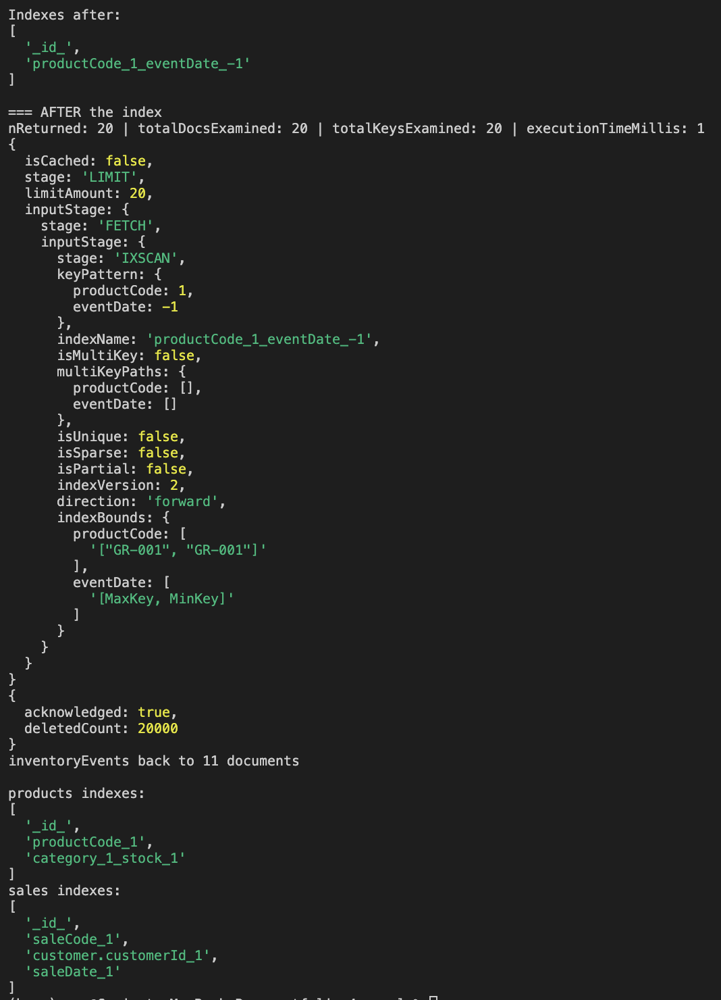
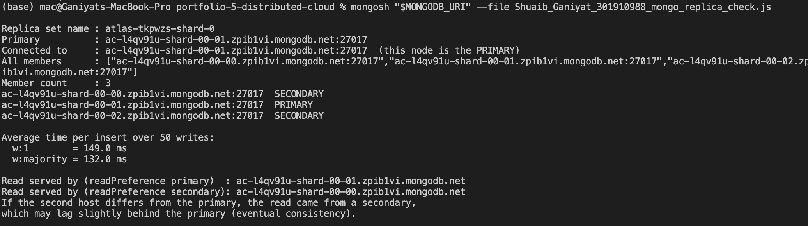

# MIT 8103 Advanced Database Systems: Final Documentation

**Full Name:** Ganiyat Shuaib
**StudentID:** 301910988  
**Matric No.:** 2026/A/MIT/0385
**Miva Email Address:** g.shuaib0988@miva.edu.ng
**Case study:** Adetwin Stores POS and Inventory Management System
**GitHub repository:** [https://github.com/gharneeyart/Shuaib_Ganiyat_301910988](https://github.com/gharneeyart/Shuaib_Ganiyat_301910988)
**Databases:** PostgreSQL 18 on Neon; MongoDB 8.0 on Atlas

## 1. Selected Case Study

Adetwin Stores is a retail and wholesale business that sells packaged foodstuff and household goods (rice, beans, cooking oil, tomato paste, beverages, laundry soap). The database supports its point-of-sale and stock records, and all five portfolios use this case study.

- **Users:** cashiers (record sales and payments), store managers (review sales and balances), inventory clerks (stock received and adjustments).
- **Major data:** customers, categories, products, sales (receipts), sale items, payments, inventory movements.
- **Key operations:** record a sale with several items; take full or part payments (credit sales); calculate outstanding balances; update stock and keep a stock ledger; report on sales, collections and stock.

## 2. The Five Portfolio Activities

**Portfolio 1: Database design and modelling.** Seven tables (customers, categories, products, sales, sale_items, payments, inventory_movements) with primary keys, foreign keys (all `ON DELETE RESTRICT`) and CHECK constraints, an ER diagram, the relational schema, and a normalisation walk-through from an unnormalised receipt to 3NF/BCNF. I kept three deliberate redundancies and explained each: the historical `unit_price` on each sale line, `line_total` as a generated column, and a stock counter on `products` derived from the movement ledger. Balances are not stored; they come from the view `v_sale_balances`, and `v_stock_reconciliation` shows any drift between counter and ledger. Tests: 30 statements that must be rejected, 6 blocks that must succeed and roll back, and 2 view checks (Figure 1).

**Portfolio 2: Query processing and optimisation.** I loaded about 200,000 sales (about 500,000 sale lines), wrote eight business queries and ran five index experiments with `EXPLAIN (ANALYZE, BUFFERS)` before and after. The composite index on `inventory_movements(product_id, movement_date DESC)` made Q7 about 400 times faster (31.7 ms to 0.079 ms, 4,907 pages to 23; Figure 2). An index on the foreign key `sale_items.product_id` made Q8 about 48 times faster. Three indexes helped little (about 1.4x to 1.5x), and the date index on `sales` did not reduce the pages read (6,339 to 6,364) because the expensive part is scanning `sale_items`.

**Portfolio 3: Transactions and concurrency.** On Neon: a restock committed and a second one rolled back; `record_sale()`, an atomic sale across five tables; a failing sale (9,999 units) that leaves no rows behind; READ COMMITTED showing a non-repeatable read (25 then 24); and REPEATABLE READ keeping its snapshot, then failing with `could not serialize access due to concurrent update` (SQLSTATE 40001), which the application must retry. The concurrency problem is two customers buying the last unit: with no control both sessions sold it; with `SELECT ... FOR UPDATE` the second session waited, read 0 and did not sell (Figure 3).

**Portfolio 4: NoSQL and advanced data models.** A document model in MongoDB Atlas, run with `mongosh`. `products` holds a flexible `attributes` object (rice has `grainType`, oil has `volumeLitres`); each sale is one document with customer snapshot, items and payments embedded, because they are read together; stock movements are a separate `inventoryEvents` collection because they grow without limit. The scripts show nested queries, an atomic guarded stock decrement, five aggregations and JSON Schema validators. On 20,000 events, a `COLLSCAN` examining 20,011 documents became an `IXSCAN` examining 20 after a compound index (Figure 4). One of the ten validation tests shows MongoDB has no foreign keys: a sale for a non-existent product is accepted.

**Portfolio 5: Distributed and cloud database.** The design covers replication (stock checks and balances read from the primary; catalogue and reports may use a replica), consistency across two databases with an outbox pattern, failure scenarios, and a shard-key comparison (`(store_id, sale_date)` proposed; a single store does not need sharding). Evidence: Neon (PostgreSQL 18.6, TLS 1.3, writable primary, compute suspended when idle) and a three-node Atlas replica set (`w:1` versus `w:majority` writes and a read served by a secondary; Figure 5). Failover, backups and sharding were discussed, not built.

**Testing.** I ran every script myself against Neon and Atlas and saved the output in each portfolio's `evidence/` folder. Results were checked, not only displayed: constraint errors name the rule, the reconciliation view shows no drift after each transaction demo, aggregations were checked against the seed data by hand, and concurrency demos used two real `psql` sessions.

## 3. Individual Technical Reflection

For me, the biggest part of this project was learning SQL properly. I started on db-fiddle, moved to PostgreSQL on my own machine, and finally to Neon, which I connect to from the terminal with `psql`. Locally I learned how a database runs and how to load scripts; on Neon I learned about connection strings, TLS, and a database that suspends when idle.

My highlight was `RETURNING`. In `record_sale()` and the concurrency demos I used it to get back the `sale_id` of a row I had just inserted, so the sale lines and payment could be linked without a second query.

This was also my first time using `mongosh`. I only knew MongoDB through Mongoose, where the schema lives in application code. Without it, I put the rules in the database with JSON Schema validators and unique indexes, and saw that MongoDB rejected bad documents but accepted a sale for a product that does not exist.

The technical results that stayed with me:
- **Portfolio 1:** the stock counter makes reads fast and gives one row to lock, but keeping it correct became the job of transactions, which is why Portfolio 3 matters to the design.
- **Portfolio 2:** three of five indexes helped very little; I learned to read buffer counts, not just time.
- **Portfolio 3:** the CHECK `quantity_in_stock >= 0` did not stop the oversell, because the stale write set stock to 0, a valid value. The fix is a lock with `SELECT ... FOR UPDATE`.
- **Portfolio 4:** I modelled MongoDB from the reads: a sale is one document because it is read as one thing.
- **Portfolio 5:** availability and consistency pull in opposite directions, and sharding is a proposal, not something this shop needs.

The hardest parts were practical: connection strings were silently empty, so `psql` and `mongosh` fell back to localhost; a `&` in the URL cut the line in `.env`; and the concurrency demos needed two terminals timed carefully. If I continued, I would add a branch column, build the outbox between PostgreSQL and MongoDB, and test a failover.

## 4. AI Use Declaration

- **Tool:** Claude Code.
- **Used for:** generating the bulk data file, revising the READMEs and this document after my files were renamed, explaining connection and tooling errors, scanning the repository for mismatches between documents, scripts and screenshots, and recreating the Portfolio 1 constraint test file from my written test record.
- **How I checked it:** I ran every database script myself on Neon and Atlas and saved the real output; the tool did not run my scripts. I compared the changed documents with that output and with my screenshots.

## 5. References

- PostgreSQL Global Development Group. *PostgreSQL documentation* (transactions, explicit locking, `EXPLAIN`, replication, partitioning). https://www.postgresql.org/docs/
- MongoDB, Inc. *MongoDB Manual* (data modelling, indexes, `explain`, replication, sharding). https://www.mongodb.com/docs/
- MongoDB, Inc. *mongosh documentation*. https://www.mongodb.com/docs/mongodb-shell/
- Neon. *Neon documentation*. https://neon.com/docs
- MongoDB Atlas. *Atlas documentation*. https://www.mongodb.com/docs/atlas/
- Course textbook and lecture notes for MIT 8103.

## Appendix: Selected Evidence

All other screenshots and saved outputs are in the `evidence/` folder of each portfolio in the repository.

**Figure 1.** Portfolio 1 constraint tests: each rejected statement names the rule it broke.

**Figure 2.** Portfolio 2, Experiment 1 (Q7): plan before (Parallel Seq Scan, 4,907 buffers) and after the composite index (Index Scan, 23 buffers).

**Figure 3.** Portfolio 3: lost update with no control (both sessions sell the last unit), then the `SELECT ... FOR UPDATE` fix (second session waits and does not sell).

**Figure 4.** Portfolio 4: `explain("executionStats")` before (COLLSCAN, 20,011 documents examined) and after the compound index (IXSCAN, 20 examined).

**Figure 5.** Portfolio 5: Atlas replica set members, `w:1` and `w:majority` writes, and a read served by a secondary.

