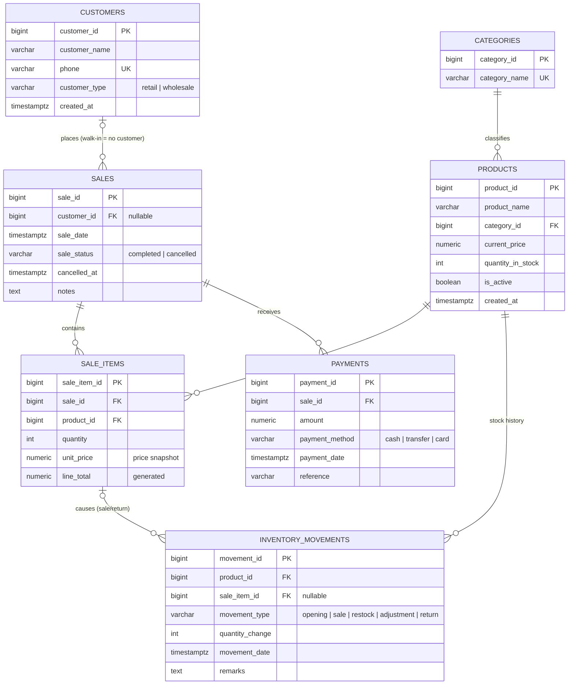

# Entity-Relationship (ER) Diagram – Adetwin Stores

The Adetwin Stores database has seven entities: `CUSTOMERS`, `CATEGORIES`,
`PRODUCTS`, `SALES`, `SALE_ITEMS`, `PAYMENTS`, and `INVENTORY_MOVEMENTS`.

Reading guide:
- A walk-in sale has no customer, so `customers` to `sales` is zero-or-many on the sales side and **optional** on the customer side (nullable FK).
- `sale_items` depends on `sales` for its identity (a line has no meaning without its sale).
- A completed sale is expected to have at least one line, but the database does not enforce this, so `sales` to `sale_items` is drawn as zero-or-many. The application adds the lines in the same transaction as the sale (Portfolio 3).
- `inventory_movements` to `sale_items` is optional: opening, restock and adjustment movements have no sale line. A sale line has one `sale` movement and possibly a later `return` movement, so it is zero-or-many in the model.

Views (derived, not stored): `v_sale_balances` (outstanding per sale) and `v_stock_reconciliation` (counter vs ledger).
